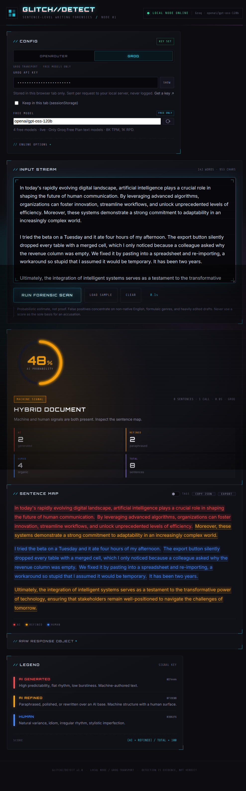

# Glitch//Detect — Business Model & Monetization Plan

**Version:** 1.0  
**Date:** 26 October 2026  
**Market:** Malawi · **Currency:** Malawi Kwacha (MK)  
**Product:** AI writing detection + humanizer for students, creators and professionals



> **Scope note:** this document defines the commercial model for the full
> platform. The current repository implements the detection dashboard, transport
> layer and free-model policy. Accounts, subscription entitlements, the humanizer,
> PayChangu billing, ads and push notifications are the monetization build
> described in [§16](#16-roadmap--milestones).

---

## Contents

1. [Executive summary](#1-executive-summary)
2. [Product status and scope](#2-product-status-and-scope)
3. [Market and customer segments](#3-market-and-customer-segments)
4. [Value proposition and positioning](#4-value-proposition-and-positioning)
5. [Business Model Canvas](#5-business-model-canvas)
6. [Plans and entitlements](#6-plans-and-entitlements)
7. [Pricing strategy](#7-pricing-strategy)
8. [Payments and subscriptions](#8-payments-and-subscriptions)
9. [Renewals, notifications and discounts](#9-renewals-notifications-and-discounts)
10. [Revenue model and unit economics](#10-revenue-model-and-unit-economics)
11. [Financial projections](#11-financial-projections)
12. [Go-to-market plan](#12-go-to-market-plan)
13. [Operations, trust and compliance](#13-operations-trust-and-compliance)
14. [KPIs and targets](#14-kpis-and-targets)
15. [Risks and mitigations](#15-risks-and-mitigations)
16. [Roadmap and milestones](#16-roadmap--milestones)
17. [Open decisions](#17-open-decisions)
18. [Appendix A — Notification copy](#appendix-a--notification-copy)
19. [Appendix B — Assumptions log](#appendix-b--assumptions-log)

---

## 1. Executive summary

Glitch//Detect is a **local-first, sentence-level AI writing detector and
humanizer** built for the realities of the Malawi market: mobile-first users,
mobile-money payments and price sensitivity. The free tier acquires users with
useful checks, ads and a small daily rewrite allowance. Premium converts the
highest-intent users with larger documents, more rewrites, more tones and an
ad-free experience.

**Core offer**

| | Free | Premium |
|---|---|---|
| AI check limit | **500 words** per check | **2,500 words** per check |
| Humanize limit | **500 words** per rewrite | **2,500 words** per rewrite |
| Rewrites | **5 per day** | **15 per day** |
| Tone options | **2** | **6** |
| Ads | Yes | **No** |
| Price | MK 0 | **MK 7,500 / month** |

**Plans:** Free, Premium Monthly, Premium 3-Month, Premium Yearly, Family
Monthly (5 seats) and Family Yearly (5 seats).

**Proposed prices**

| Plan | Price (MK) | Effective monthly | Saving |
|---|---:|---:|---:|
| Free | 0 | 0 | — |
| Premium Monthly | 7,500 | 7,500 | — |
| Premium 3-Month | 19,500 | 6,500 | 13.3% |
| Premium Yearly | 60,000 | 5,000 | 33.3% |
| Family Monthly (5 seats) | 25,000 | 5,000 / seat | 33.3% vs 5 individual plans |
| Family Yearly (5 seats) | 240,000 | 4,000 / seat | 46.7% vs 5 individual monthly plans (annualised) |

**Payments:** Airtel Money, TNM Mpamba and bank/card payments through
**PayChangu**. Prices are quoted in MWK and shown VAT-inclusive.

**Retention:** push, in-app and email reminders at 7, 3 and 1 days before expiry.
Users who pay **before expiry** receive **10% off** the renewal. Mobile-money
renewals are reminder-driven because the customer must approve each charge.

**Base-case ambition at month 12:** 5,000 monthly active users, 225 paying users
(4.5%), **MK 500K net revenue/month** and roughly break-even in a lean,
founder-led operation. Break-even is expected around **1,000–,3000 MAU** in
that lean case, or **25,000–30,000 MAU** with a small salaried team.

The model is deliberately subscription-first. Ads subsidize the free tier but are
not expected to be the main profit pool. Family plans and B2B/education seats are
the main upside beyond individual subscriptions.

---

## 2. Product status and scope

### Already built

- Flask dashboard with a cyberpunk UI.
- Sentence-level classification: **AI**, **REFINED**, **HUMAN**.
- 0–100% AI-probability gauge, counts, warnings and sentence map.
- OpenRouter and Groq transports with a **free-models-only** policy.
- Chunking, JSON repair/fallback parsing, scoring and escaped HTML highlighting.
- Copy/export of the raw analysis.
- Local-only server, key handling, CSP and security headers.
- 28 unit tests and a local end-to-end test double.

### Required for the commercial launch

| Capability | Why it matters |
|---|---|
| Accounts and sessions | Entitlements, quotas, family seats, receipts |
| Humanizer | The paid job-to-be-done; rewrites and tone changes |
| Quota service | Enforce 500/2,500 words, 5/15 rewrites per day |
| PayChangu integration | Airtel Money, TNM Mpamba, bank/card |
| Subscription state machine | Free → pending → active → grace → expired |
| Push notifications | Expiry reminders and early-renewal discount |
| Ads | Free-tier monetization |
| Analytics and admin | Conversion, churn, reconciliation, abuse |
| HTTPS + production hosting | Web push and payment callbacks require it |

### What this business model does **not** assume

- That AI-detection scores are proof of authorship. They are evidence, not a
  verdict. This must remain explicit in the product and marketing.
- That free models will remain free forever. The model includes a paid-model
  fallback and cost controls.
- That mobile-money subscriptions can auto-debit. They generally cannot without
  user approval; the renewal flow is designed around that constraint.

---

## 3. Market and customer segments

### Market context

Malawi is a mobile-first, price-sensitive market with wide mobile-money adoption
and a large English-writing population in education, media, NGOs and SMEs.
Customers are used to paying small amounts through **Airtel Money** and **TNM
Mpamba**, and many do not have or use international cards. A product priced in
MWK and payable by mobile money removes the two biggest friction points that
international writing tools ignore.

The addressable base is not “everyone who writes.” It is people who write
English regularly on a phone or laptop and have a reason to care about whether
text reads as machine-generated:

- Tertiary students and recent graduates.
- Job seekers writing CVs, cover letters and applications.
- Content creators and social-media managers.
- SME owners and marketing staff.
- NGO communications and proposal teams.
- Teachers, lecturers and writing-centre staff.
- Journalists, bloggers and newsletter writers.

### Priority segments

| Segment | Job to be done | Willingness to pay | Best entry point |
|---|---|---|---|
| University students | Check assignments, reports, applications; improve drafts | Medium; price-sensitive; family/friend sharing | Campus ambassadors, WhatsApp groups, student discounts |
| Job seekers | Make CVs and cover letters sound natural and professional | Medium; one-off need | Social ads, career pages, referrals |
| Creators / social managers | Rewrite captions and posts in a chosen tone | Medium–high; recurring | TikTok/Facebook demos, creator partnerships |
| SMEs / marketers | Humanize product and campaign copy; check agency output | High; business expense | LinkedIn, chambers of commerce, B2B seats |
| NGOs / media | Polish reports, proposals and stories | High; grant-funded | Direct sales, bulk seats |
| Educators | Teach authorship, detect suspicious submissions | Institutional | Writing-centre and university licences |

### Market sizing approach

Use a bottom-up serviceable market rather than a top-down national number:

- **Planning assumption:** 300,000 people in Malawi write English weekly on a
  connected device.
- If 10% try the product, that is **30,000 MAU**.
- At a 4% paid conversion, that is **1,200 paying users**.
- At MK 6,138 net revenue per paying user, that is **MK 7.4M net subscription
  revenue/month**, before ads and B2B.

This is a scenario, not a forecast. Validate the 300,000 figure with campus
enrolment data, telecom/Internet penetration reports and a landing-page test.

---

## 4. Value proposition and positioning

### Positioning statement

> **For Malawian students, creators and professionals who need to know whether
> writing sounds machine-generated — and want to make it sound like themselves —
> Glitch//Detect gives sentence-level evidence and humanization in one place, at
> a local price, payable with mobile money.**

### Differentiators

1. **Local payments.** Airtel Money, TNM Mpamba and bank via PayChangu. No
   international card required.
2. **Local price.** MK 7,500/month is designed for the market, not translated
   from a US price.
3. **Sentence-level evidence.** Not just a single score: every sentence is
   color-coded, so users can see *where* the signal comes from.
4. **Check + humanize loop.** Detect first, then rewrite in a chosen tone, then
   re-check. This is a stronger workflow than a standalone detector.
5. **Mobile-first and lightweight.** Works on low-end Android browsers; no heavy
   desktop app.
6. **Family sharing.** One payment covers up to five people, which fits how
   Malawian households and study groups share costs.
7. **Privacy posture.** The local-first architecture can be extended to
   no-retention processing and explicit “do not train on my text” guarantees.

### Brand promise

**“Evidence, not a verdict.”** The product should be confident about the signal
and honest about the uncertainty. That protects trust in a category where false
positives are common.

### Ethical positioning

The humanizer must not be marketed as a way to guarantee undetectable cheating.
Position it as an **editing and voice tool**: simplify, professionalize or
naturalize a draft. Publish an acceptable-use policy and guidance for educators.
This reduces platform, institutional and reputational risk.

---

## 5. Business Model Canvas

| Block | Summary |
|---|---|
| **Customer segments** | Students, job seekers, creators, SME marketers, NGOs, media, educators; family households; institutional buyers |
| **Value proposition** | Sentence-level AI evidence + humanization, local mobile-money payment, affordable MWK pricing, family sharing, privacy |
| **Channels** | Web/PWA, WhatsApp, Facebook, TikTok, campus ambassadors, radio, SEO, referrals, university/NGO partnerships |
| **Customer relationships** | Self-serve, in-app guidance, WhatsApp support, renewal nudges, campus community, B2B account management |
| **Revenue streams** | Premium subscriptions (monthly, 3-month, yearly), family plans, ads on free tier, B2B/education seats, future API |
| **Key resources** | Detection/humanizer pipeline, model-provider relationships, PayChangu integration, brand, user base, support playbook |
| **Key activities** | Inference orchestration, quota/billing, payment reconciliation, content marketing, trust and safety, retention |
| **Key partners** | PayChangu, Airtel Money, TNM Mpamba, model providers (OpenRouter/Groq and paid fallbacks), universities, hubs, ad partners |
| **Cost structure** | AI inference, payment fees, hosting, support, marketing, development, tax/compliance, ads serving |

### Flywheel

```
Free check → useful result → humanize preview → hit the 500-word/5-rewrite limit
      ↑                                                    ↓
   referral / ads ← shareable result ← Premium conversion ← pay with mobile money
      ↑                                                    ↓
   renewal discount ← push reminder ← 3-month/yearly/family plan ← usage habit
```

The free tier must be genuinely useful, not crippled. The limit should arrive at
the moment the user has seen enough value to want more.

---

## 6. Plans and entitlements

### 6.1 Plan matrix

| Entitlement | Free | Premium | Family (5 seats) |
|---|---|---|---|
| AI check — max words per request | 500 | 2,500 | 2,500 per seat |
| Humanize — max words per request | 500 | 2,500 | 2,500 per seat |
| Rewrites per day | 5 | 15 | 15 per seat |
| Tone options | 2 | 6 | 6 |
| Ads | Yes | No | No |
| Seats | 1 | 1 | Up to 5 |
| Sentence-level map | Yes | Yes | Yes |
| Gauge, counts, warnings | Yes | Yes | Yes |
| Copy/export JSON | Yes | Yes | Yes |
| Priority support | Community/FAQ | WhatsApp/email priority | WhatsApp/email priority |
| Early-renewal discount | — | 10% | 10% |
| Price | MK 0 | MK 7,500/month | MK 25,000/month or MK 240,000/year |

### 6.2 Tone options

**Free (2):**
- Standard — natural, neutral English.
- Academic — formal, precise, appropriate for reports and assignments.

**Premium (6):**
- Standard
- Academic
- Professional — business and workplace communication.
- Conversational — casual, human, social-media friendly.
- Persuasive — marketing, pitches and calls to action.
- Simple English — plain language for broad accessibility.

A **tone change** is a target-style selection made before generating a rewrite.
Changing the tone and generating again consumes another rewrite. Selecting a tone
without generating does not.

### 6.3 Metering rules

These rules must be explicit in the UI and the terms.

1. **Word count** is the number of whitespace-separated tokens in the submitted
   text. It is measured server-side, not trusted from the browser.
2. **Per-request limit.** A 501-word free request is rejected with an upgrade
   prompt; it is not silently truncated. Premium accepts up to 2,500 words.
3. **Daily reset.** Rewrite quotas reset at **00:00 CAT (UTC+2)**.
4. **Failed requests do not consume quota.** Provider errors, timeouts and parse
   failures release the reserved rewrite.
5. **A humanize request consumes one rewrite.** The pre-humanize check is
   included in that action. A standalone AI check is not counted against the
   rewrite quota.
6. **Regeneration counts.** Generating a second version, including “try another
   tone,” consumes another rewrite.
7. **Fair-use throttles.** To control abuse and inference cost, free accounts
   are soft-capped at **100 checks/day** and premium at **500 checks/day**, with
   per-minute rate limits. These are anti-abuse limits, not marketed quotas.
8. **Family seats are individual.** Each seat gets the Premium per-request and
   daily limits. The owner sees aggregate usage, never the content of another
   member’s document.
9. **Concurrency.** Quota is reserved atomically before the model call and
   released on failure, so two tabs cannot spend the same rewrite.
10. **No rollover.** Daily rewrites do not accumulate.

### 6.4 Ads on the free tier

- One native ad slot on the results page and one in the sidebar.
- No ads on the payment page, during an active scan, or inside the sentence map.
- **No behavioral targeting based on document content.** Use contextual, house
  or sponsor ads. Document text must never be sent to an ad network.
- Premium and Family are always ad-free.
- Provide a “Why am I seeing this?” link and a privacy explanation.

### 6.5 Family plan rules

- Owner pays; up to **4 additional members** are invited by phone number or
  invite link.
- Each member gets Premium limits (2,500 words, 15 rewrites/day, 6 tones,
  no ads).
- The owner can remove or replace a seat once per billing month.
- Billing reminders go to the owner; members see an in-app “ask the owner to
  renew” notice.
- Family plans are for a household or trusted group. Fair-use monitoring applies;
  obvious resale or multi-household abuse can be suspended after review.

---

## 7. Pricing strategy

### 7.1 Recommended price card

| Plan | Price (MK) | Billing | Effective monthly | Saving |
|---|---:|---|---:|---:|
| Free | 0 | — | 0 | — |
| Premium Monthly | 7,500 | Every month | 7,500 | — |
| Premium 3-Month | 19,500 | Every 3 months | 6,500 | 13.3% |
| Premium Yearly | 60,000 | Every 12 months | 5,000 | 33.3% |
| Family Monthly | 25,000 | Every month | 5,000/seat | 33.3% |
| Family Yearly | 240,000 | Every 12 months | 4,000/seat | 46.7% |

### 7.2 Early-renewal discount

If the customer pays **before the current plan expires**, apply **10% off** the
next period:

| Plan | Standard | Early renewal |
|---|---:|---:|
| Premium Monthly | 7,500 | **6,750** |
| Premium 3-Month | 19,500 | **17,550** |
| Premium Yearly | 60,000 | **54,000** |
| Family Monthly | 25,000 | **22,500** |
| Family Yearly | 240,000 | **216,000** |

Rules:

- Discount applies to the renewal price, not to add-ons.
- Valid until **23:59 CAT on the last active day**.
- The new period starts when the current period ends; the customer does not lose
  unused days by paying early.
- One discount per renewal. Do not stack with launch or referral promotions
  unless explicitly stated.
- The reminder must show the discounted price and the deadline.

### 7.3 Why these prices

- **MK 7,500/month** is the anchor. It is roughly **MK 250/day** — a small,
  understandable daily cost.
- **3-month** gives a meaningful saving without a large upfront commitment.
- **Yearly** improves cash flow, reduces monthly churn and funds acquisition.
- **Family** lowers the per-person price to **MK 5,000/month** or
  **MK 4,000/month** on annual, which fits shared student households.
- The structure moves committed users from monthly to longer plans over time,
  reducing involuntary churn from failed mobile-money renewals.

### 7.4 Discount and promotion policy

| Promotion | Offer | Guardrail |
|---|---|---|
| Early renewal | 10% off next period | Before expiry only; one per renewal |
| Launch offer | 20% off first month | First 90 days; new users only; not stackable |
| Campus ambassador | 15% off first 3 months | Verified campus code; capped volume |
| Referral | 7 days Premium for inviter and invitee | After invitee’s first paid month; capped per account |
| Win-back | 15% off for 7 days after expiry | Optional; only for users who expired in the last 30 days |

Do not discount below **MK 5,000/month effective** for individual Premium without
a cost review; that is the floor at which paid inference, payment fees, support
and VAT leave too little contribution.

### 7.5 Currency and tax

- All consumer prices are in **MWK** and **VAT-inclusive**.
- The model assumes **16.5% VAT** and a **4% all-in payment cost**. Both must be
  confirmed with a Malawi tax adviser and the signed PayChangu merchant rate.
- Review prices **quarterly** against MWK/USD movement, model costs and
  competitor pricing.
- Show the total charge, renewal date and VAT breakdown before payment.

---

## 8. Payments and subscriptions

### 8.1 Payment methods

| Method | Customer experience | Notes |
|---|---|---|
| **Airtel Money** | Enter phone number → approve the prompt on the phone | Most familiar; requires sufficient balance; user may need to retry |
| **TNM Mpamba** | Enter phone number → approve the prompt | Same flow; network downtime possible |
| **Bank / card** | PayChangu hosted checkout → 3-D Secure where required | Best for auto-renew if tokenization is supported |
| **Bank transfer** | PayChangu instructions/reference → manual or API confirmation | Allow for delayed reconciliation; activate after confirmation |

All payments run through **PayChangu**. The platform never stores card numbers.
Use PayChangu’s hosted checkout or hosted fields so card data stays inside the
PCI-compliant provider.

### 8.2 Checkout flow

1. User selects a plan and confirms the price.
2. The server creates a payment intent from its **own price table** — never from
   a client-supplied amount.
3. A unique reference is generated: `GD-{userId}-{plan}-{cycle}-{timestamp}`.
4. PayChangu returns a checkout URL; the user chooses Airtel Money, Mpamba or
   bank/card.
5. The user approves the mobile-money prompt or completes 3-D Secure.
6. PayChangu sends a webhook. The server verifies the signature/transaction with
   PayChangu and activates the entitlement **idempotently**.
7. The browser returns to a receipt page that polls/verifies the status.
8. A receipt is shown in-app and sent by email or SMS/WhatsApp where available.

**Never activate a plan from a browser redirect alone.** The webhook or a
server-to-server verification is the source of truth.

### 8.3 Subscription states

| State | Meaning | Entitlement |
|---|---|---|
| `free` | No paid plan | Free limits |
| `pending_payment` | Checkout started, not confirmed | Free limits until confirmed |
| `active` | Paid and within period | Plan limits |
| `grace` | Expired but within 48-hour grace | Plan limits; renewal prompts |
| `expired` | Grace ended | Free limits |
| `cancelled` | User turned off renewal; access until period end | Plan limits until end |

### 8.4 Renewal model

- **Mobile money:** manual renewal. Send a push/in-app/email reminder with a
  one-tap checkout link. The customer approves the charge.
- **Card:** enable tokenized auto-renew **only if PayChangu supports it** and the
  customer explicitly opts in. Show the renewal date and cancellation path.
- **Prepaid plans:** 3-month and yearly reduce the number of renewal events and
  involuntary churn.
- **Grace period:** 48 hours after expiry, with at most two reminders. Then
  downgrade to Free. Content is not deleted.

### 8.5 Reconciliation and exceptions

- Daily reconciliation between PayChangu settlements and internal transactions.
- Match on reference and transaction ID; flag duplicates and orphans.
- Duplicate payment: credit the account or refund within 5 business days.
- Failed payment: keep the user on Free, offer a retry link.
- Refund policy: case-by-case within 7 days if usage is minimal; no refund after
  substantial quota use; statutory rights prevail.
- Chargeback: suspend the entitlement pending investigation; do not delete the
  account.
- Bank transfer: mark `pending` until funds are confirmed; show the reference
  clearly.

### 8.6 Receipts and records

- In-app receipt with plan, period, amount, VAT and reference.
- Email receipt if the user has an email; SMS/WhatsApp confirmation for mobile
  money where practical.
- Retain transaction records for the period required by Malawi tax/consumer law.

---

## 9. Renewals, notifications and discounts

### 9.1 Notification ladder

| Timing | Channel | Message intent |
|---|---|---|
| **T-7 days** | Push + in-app + email | “Your Premium ends in 7 days. Renew early and save 10%.” |
| **T-3 days** | Push + in-app | Show discounted price and one-tap renewal. |
| **T-1 day** | Push + in-app + email; SMS/WhatsApp for paying users if push is unavailable | “Last day to keep your plan and save 10%.” |
| **Expiry day** | In-app banner + push | “Your plan ends today. Renew before midnight for 10% off.” |
| **T+1 day** | Push + email | “You’re on Free now. Come back — 15% off this week.” (optional win-back) |

Billing reminders are transactional. Marketing notifications require a separate
opt-in. Respect quiet hours **20:00–07:00 CAT** and cap billing notifications at
**four per renewal cycle**.

### 9.2 Discount prompt rules

- The prompt must state the **exact discounted price**, the **deadline** and what
  the user loses if they do not renew.
- The checkout link must preselect the same plan and apply the code server-side.
- The discount is valid only **before expiry**.
- If the user pays early, the new period starts at the current period’s end.
- If the user pays after expiry, the standard price applies; the optional
  win-back offer is separate.

### 9.3 Channels

1. **Web push** — primary; requires HTTPS, a service worker and user permission.
   Works on Android Chrome and on iOS for installed PWAs.
2. **In-app banner** — always available; no permission required.
3. **Email** — fallback and receipt channel.
4. **SMS / WhatsApp** — fallback for paying users at T-1 where push/email fail;
   SMS costs money, so use it sparingly.

Ask for push permission **after the first successful scan**, when the user has
seen value, not on first page load.

### 9.4 Family notifications

- Billing reminders go to the **owner**.
- Members receive an in-app notice: “The Family plan ends in 3 days. Ask the
  owner to renew.”
- The owner’s reminder says: “Renew once to keep all 5 seats.”
- Do not expose member email addresses or document content in owner reminders.

### 9.5 Notification copy

See [Appendix A](#appendix-a--notification-copy) for ready-to-use copy.

---

## 10. Revenue model and unit economics

### 10.1 Revenue streams

| Stream | Description | Share target |
|---|---|---|
| Premium subscriptions | Monthly, 3-month, yearly | 75–85% of net revenue |
| Family subscriptions | 5 seats, monthly/yearly | 10–15% |
| Ads | Free-tier display/sponsor slots | 5–10% |
| B2B / education | Bulk seats, workshops, invoicing | Upside; 5–15% by year 2 |
| Future API / white-label | Per-call or licence | Optional |

### 10.2 Unit economics of one Premium Monthly user

| Line | MK / month | Notes |
|---|---:|---|
| Gross price | 7,500 | VAT-inclusive |
| VAT (16.5% inclusive) | (1,062) | Remit to MRA; confirm treatment |
| Payment cost (4%) | (300) | Planning assumption; confirm PayChangu rate |
| **Net revenue** | **6,138** | |
| AI inference | (300) | Average usage, not the 15-rewrite maximum |
| Support / notifications | (150) | WhatsApp, email, SMS fallback |
| Refunds / moderation | (184) | 3% of net revenue |
| **Contribution** | **5,504** | Before fixed costs |

| Metric | Value |
|---|---:|
| Contribution margin (gross) | 73.4% |
| CAC target | MK 10,000 |
| Payback | ~1.8 months |
| LTV at 8% monthly churn | ~MK 68,800 |
| LTV at 12% monthly churn | ~MK 45,900 |
| LTV/CAC at 8–12% churn | 4.6–6.9× |

These are planning figures. Replace AI, payment and support assumptions with
actuals after the first 90 days.

### 10.3 Why average usage matters

The published limits are **ceilings**, not averages. A user who maxes out 15
rewrites/day at 2,500 words would consume far more inference than MK 300/month.
The model therefore requires:

- **Model routing:** free/ultra-cheap models for the free tier; a reliable paid
  model for Premium; automatic fallback.
- **Caching:** reuse checks for identical text within a short window.
- **Fair-use monitoring:** flag accounts consistently at the 95th percentile.
- **Output limits:** only return the required JSON/rewrite, not extra commentary.
- **Prompt efficiency:** avoid sending the whole document when a rewrite can be
  scoped to the selected text.

If inference costs rise, the first lever is model routing, not a price increase.

### 10.4 Ads economics

- Assume **100 impressions per free MAU/month** and a net **MK 40 per free MAU**
  after the ad network’s share (about MK 800 CPM gross, 50% share).
- Free-tier inference is assumed at **MK 30 per MAU** using free/cheap models.
- Ads therefore roughly cover free inference, not support or marketing.
- Direct sponsor slots (local banks, ISPs, universities, phone retailers) can
  outperform programmatic ads; sell them as fixed monthly placements.
- Never send document text or derived content to an ad network.

### 10.5 B2B and education pricing

| Package | Price | Notes |
|---|---:|---|
| Campus / writing-centre licence | MK 4,000/seat/month, minimum 25 seats | Annual invoicing; admin dashboard |
| SME team | MK 5,000/seat/month, minimum 10 seats | Shared billing; usage reporting |
| NGO / media | Custom | Grant-friendly invoicing; onboarding |
| Workshop / training | MK 150,000–300,000/day | Optional; builds trust and pipeline |

B2B seats have lower support cost per user and prepaid annual cash. They are the
most capital-efficient growth lever after product-market fit.

---

## 11. Financial projections

### 11.1 Base-case assumptions

| Assumption | Value |
|---|---:|
| FX (planning) | MK 1,750 = US$1 |
| VAT | 16.5% inclusive |
| Payment cost | 4% of gross |
| Net revenue per paying user | MK 6,138/month |
| Ads net revenue per free MAU | MK 40/month |
| Variable cost per paying user | MK 634/month |
| Variable cost per free MAU | MK 35/month |
| Fixed costs, month 1 | MK 1.8M/month |
| Fixed costs, month 12 | MK 2.5M/month |
| Founder salaries | Excluded (lean case) |

### 11.2 Month-12 scenarios

| Scenario | MAU | Conversion | Paying | Net subscription | Ads | Net revenue / month | Run-rate ARR |
|---|---:|---:|---:|---:|---:|---:|---:|
| Conservative | 6,000 | 2.5% | 150 | 920,700 | 234,000 | **1,154,700** | **13.9M** |
| Base | 15,000 | 3.5% | 525 | 3,222,450 | 579,000 | **3,801,450** | **45.6M** |
| Aggressive | 30,000 | 5.0% | 1,500 | 9,207,000 | 1,140,000 | **10,347,000** | **124.2M** |

“ARR” is the exit-month net revenue × 12. It is a run-rate, not audited revenue.

### 11.3 Base-case year-one ramp

| Month | MAU | Paying | Conversion | Net subscription | Ads | Total net revenue | Variable costs | Fixed costs | Contribution |
|---|---:|---:|---:|---:|---:|---:|---:|---:|---:|
| M1 | 400 | 10 | 2.5% | 61,380 | 15,600 | 76,980 | 19,990 | 1,800,000 | (1,743,010) |
| M3 | 1,500 | 45 | 3.0% | 276,210 | 58,200 | 334,410 | 79,455 | 1,900,000 | (1,645,045) |
| M6 | 4,000 | 140 | 3.5% | 859,320 | 154,400 | 1,013,720 | 223,860 | 2,100,000 | (1,310,140) |
| M9 | 8,000 | 320 | 4.0% | 1,964,160 | 307,200 | 2,271,360 | 471,680 | 2,300,000 | (500,320) |
| M12 | 15,000 | 525 | 3.5% | 3,222,450 | 579,000 | 3,801,450 | 839,475 | 2,500,000 | **461,975** |

**Break-even:** fixed costs of MK 2.5M, contribution of MK 5,504 per paying user
and MK 5 per free MAU. At 15,000 MAU, ad contribution is ~MK 72k/month, so the
lean case needs roughly **440 paying users**, or about **12,600 MAU at 3.5%
conversion**. With a small salaried team (fixed ~MK 5M), the requirement rises to
about **900 paying users / 25,000–30,000 MAU**.

### 11.4 Illustrative years 2 and 3

| Exit month | MAU | Paying | Net subscription | Ads | Net revenue / month | Fixed costs | Contribution |
|---|---:|---:|---:|---:|---:|---:|---:|
| Month 24 | 40,000 | 2,000 | 12,276,000 | 1,520,000 | 13,796,000 | 8,000,000 | ~3.2M |
| Month 36 | 100,000 | 6,000 | 36,828,000 | 3,760,000 | 40,588,000 | 20,000,000 | ~13.5M |

These are directional, not promises. They assume retention, conversion and model
costs stay within the stated ranges.

### 11.5 Sensitivity

| Change | Impact |
|---|---|
| Conversion 3.5% → 2.5% | Base M12 revenue falls ~29%; break-even moves beyond month 12 |
| Churn 8% → 12% | LTV falls ~33%; CAC payback stays acceptable only if CAC < MK 10k |
| AI cost +50% | Contribution per paying user falls ~5%; route to cheaper models first |
| Ads CPM -50% | Free tier contribution turns negative; direct sponsorships become essential |
| FX MWK devalues 20% | USD-linked inference costs rise; review prices quarterly |
| Payment fee 4% → 6% | Net revenue per paying user falls ~2%; still viable at scale |

---

## 12. Go-to-market plan

### 12.1 Launch sequence

**Pre-launch (weeks –4 to 0)**

- Build a waitlist landing page with a live demo check.
- Recruit 10–20 campus ambassadors across major universities and colleges.
- Onboard 100 beta users; test Airtel Money, Mpamba and bank payments end to end.
- Publish terms, privacy, refund and acceptable-use pages.
- Instrument analytics: signup, first check, first humanize, paywall view, checkout
  start, payment success, renewal.

**Launch (months 0–2)**

- Campus activation: short demos, QR codes, WhatsApp groups, student discounts.
- Facebook/TikTok short videos: “Does this paragraph sound like AI?” and
  “Rewrite it in your own voice.”
- Local radio and podcast interviews on AI writing and academic integrity.
- Launch offer: 20% off first month for the first 90 days.
- Referral: 7 days Premium for both sides after the invitee’s first paid month.

**Growth (months 3–6)**

- SEO: “AI detector Malawi,” “humanize AI text Malawi,” “check if AI wrote my
  essay,” “free AI writing checker.”
- Partnerships with writing centres, career-services offices, hubs and NGOs.
- Case studies: job seeker, content creator, NGO communications team.
- Family-plan campaign around exam season and holidays.
- B2B pilot with 2–3 universities or NGOs; annual invoicing.

**Retention and expansion (months 6–12)**

- Push renewal reminders and early-renewal discounts.
- Quarterly product updates: new tones, faster checks, better reports.
- Win-back campaign for expired users.
- Regional expansion research (Zambia, Zimbabwe) only after Malawi unit economics
  are proven.

### 12.2 Channel economics

| Channel | Cost | Expected role |
|---|---|---|
| Campus ambassadors | Commission + materials | High-trust acquisition; students |
| WhatsApp groups | Low | Referrals, support, reminders |
| Facebook/TikTok | Performance ads + creator posts | Volume and demos |
| SEO/content | Time + small budget | Long-term low CAC |
| Radio/podcast | Fixed fee | Credibility and mass awareness |
| Partnerships | Revenue share / bulk discount | B2B and institutional trust |
| Referral | 7 days Premium | Low-CAC organic growth |

Target blended CAC: **MK 6,000–10,000** per paying user. Do not scale a channel
above a 3-month CAC payback without evidence of retention.

### 12.3 Launch offer rules

- 20% off the first month only.
- New users only; one per account/phone number.
- Not stackable with early-renewal or referral credits.
- Cap the campaign budget and measure conversion by channel.

---

## 13. Operations, trust and compliance

### 13.1 Support

- WhatsApp Business + email + in-app FAQ.
- Response target: 24 hours on business days; 48 hours on weekends.
- Refund and payment-failure playbook with saved replies.
- Escalation path for duplicate charges and account access issues.

### 13.2 Trust and safety

- Publish an acceptable-use policy: no illegal content, harassment, malware or
  impersonation.
- Do not promise “100% undetectable” or “guaranteed human.” Detection is
  probabilistic.
- Give educators a way to report misuse; provide guidance on AI and authorship.
- Rate-limit and monitor for automated scraping, multi-account abuse and resale
  of family seats.
- Keep a manual review path for appeals and false-positive complaints.

### 13.3 Privacy and data

- **Default no-retention:** process document text and discard it after the
  response. Do not use customer text to train models.
- If history is added later, make it opt-in, encrypted and deletable.
- Store only the minimum account data: phone/email, plan, quota counters,
  payment references, push subscription.
- Never send document text to ad networks or analytics.
- Publish a privacy policy and a data-deletion path.
- Confirm obligations under Malawi’s data-protection, electronic-transactions and
  consumer-protection laws with local counsel.

### 13.4 Tax and business registration

- Register the business and tax accounts with the relevant Malawi authorities.
- Confirm **16.5% VAT** treatment for digital services and whether prices must be
  shown inclusive.
- Issue receipts with VAT breakdown where required.
- Keep payment and refund records for the statutory period.
- Revisit tax treatment before cross-border expansion.

### 13.5 Security

- HTTPS everywhere; HSTS; secure cookies.
- PayChangu webhook signature verification and idempotency.
- Server-side price catalog; never trust the client’s amount or plan.
- No card data stored; hosted checkout only.
- Rate limits, bot protection and phone/email verification for free accounts.
- Admin access with 2FA and audit logs.
- Daily backups; documented restore test.

### 13.6 Production architecture additions

- PostgreSQL (or managed SQLite for early beta) for users, plans, payments and
  quota counters.
- Redis for atomic quota reservations and rate limits.
- Gunicorn + Nginx (or a managed platform) behind HTTPS; the current Flask dev
  server is not a production server.
- Scheduler/Celery for renewal reminders, receipt emails and reconciliation.
- Service worker + VAPID keys for web push.
- Admin dashboard for payments, refunds, plan changes and abuse review.

---

## 14. KPIs and targets

### Acquisition

| KPI | Target (first 6 months) |
|---|---|
| Landing-page → signup | ≥ 25% |
| Signup → first check | ≥ 70% |
| Blended CAC | MK 6,000–10,000 |
| CAC payback | ≤ 3 months |

### Engagement

| KPI | Target |
|---|---|
| Checks per active user / week | ≥ 3 |
| Humanizes per paying user / week | ≥ 5 |
| D7 retention | ≥ 25% |
| D30 retention | ≥ 12% |
| Free → paid conversion | 3–5% by month 6 |

### Monetization

| KPI | Target |
|---|---|
| Monthly churn (individual monthly) | ≤ 8–12% |
| 3-month / yearly share of new sales | ≥ 35% by month 9 |
| Renewal rate (prepaid) | ≥ 75% |
| Family attach rate | ≥ 10% of paying accounts |
| ARPU (blended, net) | ≥ MK 6,000 |
| Ads net revenue per free MAU | ≥ MK 30–40 |
| LTV/CAC | ≥ 3× |

### Product and operations

| KPI | Target |
|---|---|
| p95 analysis latency | ≤ 30 s for 500 words |
| Failed analysis rate | < 2% |
| Quota/abuse flags reviewed | 100% within 48 h |
| Payment reconciliation | Daily, 100% matched |
| Push opt-in rate | ≥ 40% of paying users |
| Support first response | ≤ 24 h |

---

## 15. Risks and mitigations

| Risk | Likelihood | Impact | Mitigation |
|---|---|---|---|
| Free models disappear or degrade | High | High | Multi-provider routing; paid fallback; model health checks; cache |
| Inference costs exceed plan economics | Medium | High | Route free tier to cheapest models; cache; fair-use caps; monitor p95 usage |
| Payment failures / mobile-money downtime | High | Medium | Multiple methods; retry links; 48 h grace; daily reconciliation |
| Low ad CPMs or ad-blocking | High | Medium | Direct local sponsors; house ads; keep ads secondary to subscriptions |
| Free-tier abuse / multi-accounting | Medium | Medium | Phone verification; device/IP limits; quota reservation; manual review |
| Accuracy complaints / false positives | Medium | High | “Evidence, not verdict” messaging; confidence context; appeals; feedback loop |
| Academic-integrity backlash | Medium | High | Ethical positioning; acceptable-use policy; educator guidance; no “undetectable” claims |
| MWK devaluation / inflation | High | Medium | Quarterly price review; MWK pricing; USD cost dashboard |
| PayChangu dependency | Medium | High | Contract review; second gateway backup; manual bank reconciliation |
| Data breach / privacy incident | Low | High | Minimize data; no document retention; encryption; access controls; incident plan |
| Family-seat resale | Medium | Low–Medium | Fair-use monitoring; seat change limits; suspend obvious resale |
| Seasonality (academic calendar) | High | Medium | Holiday campaigns; job-seeker and creator segments; annual plans |

---

## 16. Roadmap and milestones

### Phase 1 — Monetization foundation (weeks 0–6)

- Accounts (phone/email OTP) and sessions.
- Plan catalog and entitlement middleware.
- Quota reservation: 500/2,500 words; 5/15 rewrites; daily reset.
- Humanizer MVP with the two free tones and six premium tones.
- PayChangu integration for monthly and 3-month plans.
- Webhook verification, idempotency, receipts, refunds playbook.
- In-app expiry banner and basic email reminders.
- Admin view for payments and users.

**Exit criteria:** 50 paying beta users; 99% payment reconciliation; < 2% failed
analysis; quota cannot be bypassed from the browser.

### Phase 2 — Retention and family (weeks 7–12)

- Yearly plans and Family plans (5 seats).
- Web push (VAPID) at T-7/T-3/T-1; early-renewal 10% discount.
- Ads on the free tier with privacy-safe placements.
- Referral program.
- Analytics dashboard (conversion, churn, plan mix, CAC).
- Win-back campaign.

**Exit criteria:** renewal rate ≥ 60% in beta; push opt-in ≥ 40%; family attach
≥ 5%.

### Phase 3 — Scale (months 4–6)

- B2B/education packages and invoicing.
- Model routing and caching to protect margin.
- PWA install flow; improved low-end Android performance.
- More tones and document-level reports.
- Support automation and self-serve refunds.

**Exit criteria:** 5,000+ MAU; 3%+ conversion; contribution-positive in the lean
case.

### Phase 4 — Expansion (months 6–12)

- 15,000+ MAU base case; 525+ paying users.
- Regional research (Zambia, Zimbabwe) and pricing localization.
- API/white-label evaluation.
- Annual price review and model-cost audit.

---

## 17. Open decisions

These need a decision before or during beta:

1. **Confirm the 3-month, yearly and family prices.** The numbers here are a
   coherent proposal, not a mandate.
2. **Free check volume.** Should free checks be unlimited within fair use, or
   explicitly capped (e.g., 20/day)? The current model assumes a soft anti-abuse
   cap, not a marketed cap.
3. **Tone list.** Confirm the six premium tones and whether Chichewa should be
   added.
4. **Family quotas.** Per-seat 15 rewrites/day (proposed) vs a shared family pool.
5. **Refund policy.** 7-day/limited-use refund vs no refunds after generation.
6. **Auto-renew.** Confirm whether PayChangu supports card tokenization and
   recurring charges; mobile money will remain reminder-driven.
7. **Ad partner.** Programmatic network vs direct local sponsors vs house ads.
8. **Student pricing.** A separate verified student plan, or campus codes only?
9. **B2B pricing.** Confirm the minimum seats and annual invoicing terms.
10. **Data retention.** No-retention default vs opt-in history.

---

## Appendix A — Notification copy

Short, specific and price-led. Use the user’s plan name and the exact deadline.

**T-7 days (push / email)**

> **Your Premium ends in 7 days.**  
> Renew before 30 Nov and get **10% off** — MK 6,750 instead of MK 7,500.  
> [Renew with 10% off]

**T-3 days (push / in-app)**

> **3 days left on Premium.**  
> Keep 2,500-word checks, 15 rewrites/day and no ads. Renew early for **10% off**.  
> [Keep my plan — MK 6,750]

**T-1 day (push / email / SMS fallback)**

> **Last day: your Premium ends tomorrow.**  
> Renew before midnight to keep your plan and save **10%**.  
> [Renew now]

**Expiry day (in-app)**

> **Your Premium ends today.**  
> You’ll move to Free (500 words, 5 rewrites/day). Renew before midnight for 10% off.  
> [Renew with 10% off]

**T+1 day (win-back, optional)**

> **You’re on Free now.**  
> Come back this week and get **15% off** your next Premium month.  
> [Restart Premium]

**Family owner (T-3)**

> **Your Family plan ends in 3 days.**  
> Renew once to keep all 5 seats. Pay before expiry and save **10%**.  
> [Renew Family — MK 22,500]

**Family member (in-app)**

> **The Family plan ends in 3 days.**  
> Ask the plan owner to renew so your 2,500-word checks and rewrites continue.

**Payment success**

> **Payment received — Premium is active.**  
> Your plan runs until 30 Nov 2026. Receipt: GD-…  
> [View receipt]

---

## Appendix B — Assumptions log

Update this table as real data arrives.

| Assumption | Current value | Source / next step |
|---|---|---|
| FX rate | MK 1,750 = US$1 | Planning; update monthly |
| VAT | 16.5% inclusive | Confirm with Malawi tax adviser |
| Payment cost | 4% all-in | Confirm PayChangu merchant rate |
| Net revenue per paying user | MK 6,138/month | Derived from gross, VAT and payment cost |
| AI cost per paying user | MK 300/month | Measure after 90 days; route models |
| AI cost per free MAU | MK 30/month | Measure; use free/cheap models |
| Ads net per free MAU | MK 40/month | Measure CPM/fill; direct sponsors |
| Support cost per paying user | MK 150/month | Measure ticket volume |
| Refunds/moderation | 3% of net | Measure |
| Monthly churn | 8–12% | Measure by plan |
| Conversion | 2.5–5% of MAU | Measure by cohort |
| CAC | MK 6,000–10,000 | Measure by channel |
| Fixed costs (lean) | MK 1.8–2.5M/month | Build bottom-up budget |
| Fixed costs (team) | ~MK 5M+/month | Add salaries and office |
| Break-even | 12–15k MAU lean | Recalculate monthly |
| 3-month price | MK 19,500 | Test 19,500 vs 20,000 |
| Yearly price | MK 60,000 | Test 60,000 vs 67,500 |
| Family monthly | MK 25,000 | Test 25,000 vs 30,000 |
| Family yearly | MK 240,000 | Test 240,000 vs 270,000 |

---

**Bottom line:** the free tier creates habit and ad inventory; Premium and Family
convert the users who hit the limits; mobile money and PayChangu remove the
payment barrier; early-renewal discounts and push reminders protect revenue. The
lean case breaks even around 12,000–15,000 MAU. The biggest execution risks are
inference cost, payment failure and trust — not demand.
